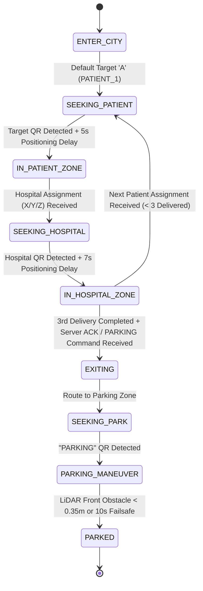

# B3RB ROS Line Follower — Session Context, Logic & Technical Specification

## 1. Executive Summary & Overview
This document contains the complete context, state machine design, mathematical formulations, and code implementations developed for the NXP B3RB ROS2 autonomous vehicle system (`b3rb_ros_line_follower` package). 

The vehicle performs autonomous line following, QR code target identification, server communication, obstacle avoidance, and automatic LiDAR-based parking maneuver with real-time kinematic trajectory guide visualization.

---

## 2. System Architecture & State Machine

### 2.1 Top-Level Mission State Flow
The vehicle is driven by a behavior-tree state machine (`MissionController` & `PatientCycleBehavior`):



---

## 3. Detailed Logic & Feature Specifications

### 3.1 Startup & Target Defaults
- **Immediate Target 'A'**: On startup (`ENTER_CITY`), the buggy immediately sets `current_patient_target = PATIENT_1` (Target `'A'`) and begins navigating without waiting for an initial manual start command.
- **Manual Assignment Onwards**: Subsequent mission legs wait for server messages or `payload_sender.py` commands.

### 3.2 Post-Intersection Cooldown & Detection Pause
- **Signboard Cooldown**: After clearing an intersection (`vector_count > 0` after intersection), signboard processing is ignored for **3.0 seconds** (`current_time - last_turn_clear_time < 3.0`) to avoid duplicate triggers.
- **YOLO Inference Pause**: Pauses object recognition for **10.0 seconds** when target server commands are received to save CPU/GPU resources.

### 3.3 Hospital Resumption with Virtual Straight Vectors
- **Problem**: Stopping at a hospital signboard can cause line markers to become obscured or skewed.
- **Solution**:
  - When resuming from a hospital stop (`IN_HOSPITAL_ZONE` $\rightarrow$ `SEEKING_PATIENT`), if the camera detects lane lines (`vector_count > 0`), standard line-following corrects vehicle orientation relative to the track.
  - If lane lines are missing (`vector_count == 0`), the system generates **virtual straight edge vectors** for **4.0 seconds**:
    - `image_width = 640`, `image_height = 480`
    - Left vector: $(160, 0) \rightarrow (160, 480)$
    - Right vector: $(480, 0) \rightarrow (480, 480)$
  - **Benefit**: Ensures the Lattice Planner and obstacle avoidance stay fully operational instead of using blind unguided steering.

### 3.4 3rd Hospital Server ACK Requirement
- When completing the 3rd hospital delivery (`patients_done == 3`), the rover stops and publishes its report to the server via `/ServerCommunication`.
- It **remains stopped** until receiving a server delivery ACK (`received_ack == True`) or a `"PARKING"`/`"DONE"` message before setting `mission_state = "EXITING"`.

### 3.5 LiDAR-Based Automatic Parking (`ParkingBehavior`)
- **Corridor Scanning**: Operates a P-controller centered between cone rows marking the bay:
  - Scanning window: Forward distance $x \in [0.1, 1.5]\text{ m}$, lateral span $y \in [-0.6, 0.6]\text{ m}$.
- **Steering Control**:
  $$\text{lateral\_error} = d_{\text{right}} - d_{\text{left}}$$
  $$\text{steer} = \text{clamp}(\text{lateral\_error} \times 1.8,\; -0.5,\; 0.5)$$
  - Approach speed: `0.25 m/s`.
- **Stop Conditions**:
  - Front barrier detected within $0.35\text{ m}$ ($x \in [0.05, 0.35]\text{ m}$, $|y| < 0.35\text{ m}$).
  - 10.0-second failsafe timeout.

### 3.6 Payload Sender GUI (`payload_sender.py`)
- Includes target dispatch buttons (`A`, `B`, `C`, `X`, `Y`, `Z`), `Send ACK`, and a dedicated orange **`Send PARKING`** button for instant manual parking sequence testing.

---

## 4. Kinematic Parking Guide Visualization

### 4.1 Physics Kinematics — Ackermann Steering Geometry
Given physical steering angle $\delta = \delta_n \cdot 30^\circ$, wheelbase $L = 0.36\text{ m}$, and track width $T = 0.22\text{ m}$:

$$\text{Turning Radius at Midpoint: } R = \frac{L}{\tan(\delta)}$$

$$\text{Left Wheel Rail: } R_L = \text{sign}(\delta) \cdot \left(R - \frac{T}{2}\right)$$
$$\text{Center Trajectory: } R_C = \text{sign}(\delta) \cdot R$$
$$\text{Right Wheel Rail: } R_R = \text{sign}(\delta) \cdot \left(R + \frac{T}{2}\right)$$

### 4.2 Perspective Projection — 3D Ground to 2D Camera Image
Given ground coordinates $(x_g, y_g)$, camera height $h_{cam} = 0.25\text{ m}$, and downward pitch $\phi = 22^\circ$:

$$\text{depth} = y_g \cos(\phi) + h_{cam} \sin(\phi)$$
$$v = c_y + f_v \cdot \frac{h_{cam} \cos(\phi) - y_g \sin(\phi)}{\text{depth}}$$
$$u = c_x - f_u \cdot \frac{x_g}{\text{depth}}$$

- **Perception Window Output**: Renders cyan outer wheel rails, bright green center trajectory arc, and yellow distance tick marks every 0.5m during `PARKING_MANEUVER` and `SEEKING_PARK`.

---

## 5. Core Implementation Code Blocks

### 5.1 Parking Guide Data Publisher (`b3rb_ros_line_follower.py`)
```python
    def tick_bt_and_publish(self):
        self.bt_root.tick(self)
        
        msg = Joy()
        msg.buttons = [1, 0, 0, 0, 0, 0, 0, 1]
        is_overtaking = 1.0 if getattr(self, 'overtake_state', 'IDLE') != 'IDLE' else 0.0
        msg.axes = [0.0, self.target_speed, is_overtaking, self.target_turn]
        self.publisher_joy.publish(msg)

        # Publish parking guide data for perception window visualization
        guide_msg = String()
        guide_msg.data = json.dumps({
            'mission_state': self.mission_state,
            'steer': float(self.target_turn),
            'speed': float(self.target_speed),
        })
        self.publisher_parking_guide.publish(guide_msg)
```

### 5.2 Parking Behavior & 3rd Hospital ACK Check (`b3rb_ros_line_follower.py`)
```python
class ParkingBehavior(Behavior):
    def __init__(self):
        self.start_time = None
        
    def tick(self, node):
        current_time = node.get_clock().now().nanoseconds / 1e9
        if self.start_time is None:
            self.start_time = current_time
            node.get_logger().info("ParkingBehavior: Entering parking bay.")
            
        elapsed = current_time - self.start_time
        if node.latest_scan is None:
            node.rover_move_manual_mode(0.0, 0.0)
            return NodeStatus.RUNNING
            
        scan = node.latest_scan
        angles = np.arange(scan.angle_min, scan.angle_max, scan.angle_increment)
        ranges = np.array(scan.ranges)
        n = min(len(angles), len(ranges))
        angles, ranges = angles[:n], ranges[:n]
        
        valid = (ranges > scan.range_min) & (ranges < 4.0) & ~np.isinf(ranges)
        ranges, angles = ranges[valid], angles[valid]
        obs_x = ranges * np.cos(angles)
        obs_y = ranges * np.sin(angles)
        
        # 1. Front barrier detection (< 0.35m)
        front_mask = (obs_x > 0.05) & (obs_x < PARKING_STOP_FRONT_DIST) & (np.abs(obs_y) < 0.35)
        if np.any(front_mask):
            node.rover_move_manual_mode(0.0, 0.0)
            node.get_logger().info("ParkingBehavior: Front obstacle reached — parked.")
            self.start_time = None
            return NodeStatus.SUCCESS
            
        # 2. Timeout failsafe
        if elapsed > PARKING_TIMEOUT_SEC:
            node.rover_move_manual_mode(0.0, 0.0)
            node.get_logger().warn("ParkingBehavior: Timeout — stopping as failsafe.")
            self.start_time = None
            return NodeStatus.SUCCESS
            
        # 3. Cone corridor centering P-controller
        corridor_mask = (obs_x > 0.1) & (obs_x < PARKING_CORRIDOR_X_MAX) & (np.abs(obs_y) < PARKING_CORRIDOR_Y_MAX)
        cy = obs_y[corridor_mask]
        
        steer = 0.0
        if len(cy) > 0:
            left_pts = cy[cy > 0]
            right_pts = cy[cy < 0]
            left_dist = np.min(left_pts) if len(left_pts) > 0 else PARKING_CORRIDOR_Y_MAX
            right_dist = np.min(np.abs(right_pts)) if len(right_pts) > 0 else PARKING_CORRIDOR_Y_MAX
            
            lateral_error = right_dist - left_dist
            steer = max(-PARKING_MAX_STEER, min(PARKING_MAX_STEER, lateral_error * PARKING_CENTERING_GAIN))
            
        node.rover_move_manual_mode(PARKING_APPROACH_SPEED, steer)
        return NodeStatus.RUNNING
```

### 5.3 Virtual Straight Vector Generation (`b3rb_ros_line_follower.py`)
```python
        current_time = node.get_clock().now().nanoseconds / 1e9
        resume_time = getattr(node, 'hospital_resume_time', 0.0)
        vectors = node.vectors
        if getattr(node, 'hospital_resume_straight', False):
            if resume_time > 0.0 and (current_time - resume_time) < 4.0:
                if vectors is None or vectors.vector_count == 0:
                    # Construct virtual straight edge vectors for 4.0s
                    from synapse_msgs.msg import EdgeVectors
                    virtual_vectors = EdgeVectors()
                    virtual_vectors.image_width = 640
                    virtual_vectors.image_height = 480
                    virtual_vectors.vector_count = 2
                    
                    virtual_vectors.vector_1[0].x, virtual_vectors.vector_1[0].y = 160.0, 0.0
                    virtual_vectors.vector_1[1].x, virtual_vectors.vector_1[1].y = 160.0, 480.0
                    virtual_vectors.vector_2[0].x, virtual_vectors.vector_2[0].y = 480.0, 0.0
                    virtual_vectors.vector_2[1].x, virtual_vectors.vector_2[1].y = 480.0, 480.0
                    
                    vectors = virtual_vectors
            else:
                node.hospital_resume_straight = False
                node.hospital_lane_memory_active = False
```

### 5.4 Ackermann Trajectory Projection (`b3rb_ros_edge_vectors.py`)
```python
    def _draw_parking_guide_arcs(self, image, steer):
        H, W = image.shape[:2]
        if H == 0 or W == 0:
            return image

        fov_h_deg, fov_v_deg = 62.0, 48.0
        f_u = W / (2.0 * math.tan(math.radians(fov_h_deg / 2.0)))
        f_v = H / (2.0 * math.tan(math.radians(fov_v_deg / 2.0)))
        cx, cy = W / 2.0, H / 2.0
        h_cam, phi = 0.25, math.radians(22.0)

        L, T = self.WHEELBASE_M, self.TRACK_WIDTH_M
        delta = steer * math.radians(30.0)

        if abs(delta) < 0.01:
            radii, offsets = None, [-T / 2.0, 0.0, T / 2.0]
        else:
            R = L / math.tan(abs(delta))
            sign = 1.0 if delta >= 0 else -1.0
            radii, offsets = [sign * (R - T / 2.0), sign * R, sign * (R + T / 2.0)], None

        def ground_to_pixel(x_gnd, y_gnd):
            depth = y_gnd * math.cos(phi) + h_cam * math.sin(phi)
            if depth <= 0.05:
                return None
            v = int(cy + f_v * (h_cam * math.cos(phi) - y_gnd * math.sin(phi)) / depth)
            u = int(cx - f_u * x_gnd / depth)
            if 0 <= u < W and 0 <= v < H:
                return (u, v)
            return None

        overlay = image.copy()
        colors, widths = [(0, 200, 255), (0, 255, 0), (0, 200, 255)], [2, 3, 2]

        if radii is None:
            for off, col, wd in zip(offsets, colors, widths):
                pts = [ground_to_pixel(off, Y_START + (Y_MAX - Y_START) * k / N_STEPS) for k in range(N_STEPS + 1)]
                pts = [p for p in pts if p]
                for i in range(len(pts) - 1):
                    cv2.line(overlay, pts[i], pts[i+1], col, wd, cv2.LINE_AA)
        else:
            for R_arc, col, wd in zip(radii, colors, widths):
                pts = []
                for k in range(N_STEPS + 1):
                    arc_len = Y_START + (Y_MAX - Y_START) * k / N_STEPS
                    theta = arc_len / R_arc
                    x_g = R_arc * (1.0 - math.cos(theta))
                    y_g = abs(R_arc) * math.sin(abs(theta))
                    px = ground_to_pixel(-x_g, y_g)
                    if px:
                        pts.append(px)
                for i in range(len(pts) - 1):
                    cv2.line(overlay, pts[i], pts[i+1], col, wd, cv2.LINE_AA)

        cv2.addWeighted(overlay, 0.75, image, 0.25, 0, image)
        return image
```
